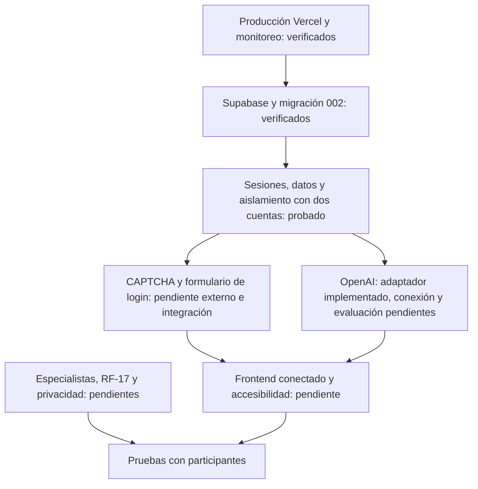

# Estado verificable del backend

**Decisión posterior del usuario:** CAPTCHA aplazado; prioridad actual OpenAI y respaldo Git. El login público continúa protegido y no se marca CAPTCHA como cumplido. Ver [OPENAI-CONEXION.md](OPENAI-CONEXION.md) para preparar clave, crédito y evaluación sintética.

**OpenAI conectado desde el entorno local:** seis solicitudes sintéticas reales aprobadas (HTTP 200 y filtros/esquema). Ver [EVALUACION-IA-INICIAL.md](EVALUACION-IA-INICIAL.md). El saldo y configuración OpenAI de Vercel no se verificaron; la activación de AI_MODE se hace por entorno. Los estados anteriores de clave ausente que aparecen abajo son históricos.

5 de noviembre de 2026. Documento vigente para el cierre técnico. No equivale a declarar terminado el frontend, el producto clínicamente validado ni todos los criterios del PRD.

## Esquema de avance



## Terminado y comprobado en esta revisión

- Se corrigieron TS2688 de node y vite/client: typeRoots se resuelve desde el proyecto y los tipos de Vite quedan en frontend/src/vite-env.d.ts. La compilación remota de Vercel terminó sin esos errores. Node queda fijado a 24.x; no se cambia automáticamente a otra versión mayor.
- Se corrigió POST /settings/preview para aceptar el contrato documentado `{settings:{...}}`. Tiene una prueba de regresión y se probó en producción sin persistencia ni proveedor IA.
- Diagnóstico remoto de health GET/HEAD, sesión sin cookies, Auth de Supabase, esquema 002 y acceso de servidor a entries sin filas: aprobado.
- Recorrido con dos cuentas sintéticas en Supabase y la API pública: aprobado. Incluyó sesiones reales, creación/edición/versionado del diario, denegación de GET/PATCH/DELETE cruzado y comprobación de lectura/escritura cruzada mediante REST de Supabase.
- Consentimientos independientes, preferencias persistentes, vista previa simulada, perfil manual, pausa repetida con contador único, exportación y borrado con cascada de conversación: aprobados en ese recorrido.
- Cierre remoto invalida la sesión y assert_live_session; eliminación de cuenta borra su perfil y bloquea acceso posterior. Las dos cuentas creadas para la prueba se eliminaron al terminar. No se tocaron cuentas existentes.
- 61 pruebas TypeScript aprobadas en un único proceso, comprobación de tipos y pruebas SQL embebidas aprobadas. El runner normal y el build local encontraron spawn EPERM en este entorno Windows; se usó `node --test --test-isolation=none backend/tests/*.test.ts shared/tests/*.test.ts` y la compilación completa se verificó en Vercel.
- No se llamó a OpenAI ni se envió correo desde las pruebas. No se cambiaron las claves del usuario.

## Pendientes para una demo funcional con interfaz

1. **CAPTCHA y login de navegador.** Crear Turnstile, activarlo realmente en Supabase y luego declarar AUTH_CAPTCHA_ENABLED=true en Vercel. Conectar el widget y formulario al endpoint existente. Probar token válido, inválido y reutilizado, cookies, refresh y logout desde navegador. Las sesiones del test real se obtuvieron directamente de Auth; no prueban el login BFF con CAPTCHA.
2. **Cuentas permanentes del equipo.** Crear usuarios de demo por administración, deshabilitar registro público y habilitar app_metadata.challenge_member=true. Las cuentas temporales eliminadas no son cuentas para entrar en la página. Procedimiento en CAPTCHA-Y-ACCESO.md y DESPLIEGUE.md.
3. **OpenAI.** Configurar crédito/clave y modelo admitido, comprobar consumo real y ejecutar el banco sintético antes de activar para la demo. La clave local sigue ausente y AI_MODE=disabled. Alternativa temporal: modo mock explícito una vez conectado el frontend, sin fingir respuestas reales.
4. **Frontend.** El diseño previo continúa siendo una demo local; aún no consume los datos del backend. Conectar sesión, diario, permisos, perfil, respuestas separadas, exportación y eliminación según API-BACKEND.md. Resolver limpieza de borradores, texto sin HTML ejecutable y WCAG 2.2 AA con pruebas de interfaz.

## Pendientes para afirmar cumplimiento completo del PRD

- RF-17: existe pausa técnica, pero faltan escenarios, mensaje y recursos aprobados por especialistas. No se implementó un protocolo clínico inventado ni detección automática.
- RF-08: rechazo de patrones por clave exacta; no hay garantía de bloqueo semántico de todas las paráfrasis. El criterio sigue parcial.
- RF-11: política actual de cascada o cancelar. Conservar derivados como manuales requiere decisión y desarrollo si se elige esa opción.
- RF-15: demo por invitación; autorregistro y recuperación pública no implementados. Condiciones para adolescentes y verificación de edad pendientes de definición.
- Privacidad: retención, copias de seguridad, avisos y revisión institucional pendientes. Las pruebas no certifican eliminación en proveedores externos ni aprobación ética.
- Evaluación de IA real, pruebas de concurrencia/carga, matriz de navegadores y accesibilidad pendientes. Las pruebas del recorrido cubren algunos casos de RLS/cascada, no certifican todos los recursos y escenarios posibles.
- Riesgo comunicado anteriormente: las claves aparecieron en una captura. El usuario decidió no rotarlas; no se registra ese riesgo como resuelto.

## Comandos disponibles

```powershell
npm run check
npm test
npm run test:db
npm run check:connections
npm run build
```

Para repetir el recorrido que crea y elimina dos cuentas ficticias:

```powershell
npm run test:live -- --confirm-synthetic-users
```

Este último comando escribe datos sintéticos en el Supabase configurado y prueba https://grandaptive.vercel.app; comprobar que ambos correspondan a GRANDAPTIVE. No imprime credenciales ni usa IA. Si CAPTCHA está activo y exige interacción, se detiene y limpia las cuentas; no desactivarlo para lograr un PASS. No interrumpir el proceso durante la limpieza. Si informa limpieza pendiente, usar exclusivamente los UUID sintéticos señalados para revisar el incidente; nunca borrar usuarios por prefijo o en bloque.

Cambiar únicamente variables en Vercel requiere redeploy. Cambiar archivos locales requiere publicar el código actualizado. Las migraciones se aplican a Supabase por separado. `.env.local` no se sube a Git.

## Evidencia remota

La publicación con corrección TS2688 y preview fue `dpl_HLDfEQHdtCdcLCjgnsJrnD9Lvcn9` (05/11/2026, compilación 20:16 UTC / 14:16 Ciudad de México). El inspector de Vercel reportó READY y logs sin TS2688. Los checks posteriores usaron el dominio estable grandaptive.vercel.app. Las publicaciones siguientes pueden añadir documentación o cabeceras sin cambiar ese resultado histórico.
